<div align="center" dir="rtl">

# 🦁 XXD Shop 005 | مشاهد تجميل مشرقة

### الزجاجة التي قد تلتقطها عفوياً في بيت مرتب جداً

<a href="README.md">简体中文</a> · <a href="README.en.md">English</a> · <a href="README.ja.md">日本語</a> · <a href="README.ko.md">한국어</a> · <strong>العربية</strong>

</div>

**صوّر منتج التجميل أو العناية بالبشرة في بيت مشرق مرتب يبدو كالحياة الحقيقية.**
إحساس يومي بكاميرا حقيقية، لكن بترتيب بيت شخص ذي ذوق رفيع — والمنتج هو أسطع وأوضح ما في الإطار.

| بنظرة واحدة | |
|---|---|
| **ما تعطيه** | صورة المنتج (موصى بها) أو اسمه، وسطر واحد عن استخدامه مثل «سيروم الصباح» أو «لوشن الجسم في الحمّام» |
| **ما تحصل عليه** | صور حياتية بأسلوب Xiaohongshu وصور مشاهد للمتجر؛ وكذلك مجموعة دوّارة في بيت واحد |
| **ملامح الأسلوب** | ضوء نهار عالي الإضاءة · بلا زوايا مظلمة أو ظلال ثقيلة · أغراض قليلة ومرتبة · طبق خزفي أو صينية حجرية أو سطح نظيف · بلا نص افتراضياً |
| **الأنسب لـ** | الصور الحياتية وصور المشاهد للتجميل والعناية بالبشرة والعناية الشخصية والعطور |

> **بعد التثبيت، قل فقط:**
>
> /xxd-shop-005 اصنع صورة حياتية لسيروم النياسيناميد هذا

<!-- xxd-samples:start -->
## نماذج

<p align="center"><a href="assets/examples/s02-size-3x4-1086x1448.png">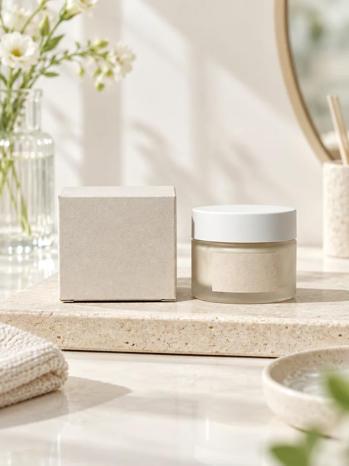</a><br><sub>منشور على Xiaohongshu · 3:4 · 1086x1448<br>كريم بلمسة مطفأة ناعمة من QIBAI · <a href="assets/examples/sources/product-qibai-cream.jpg">صورة المنتج</a> + <a href="assets/examples/sources/logo-qibai.png">Logo</a> · بلا نص</sub></p>

### الفئات بنظرة واحدة

مربع لكل فئة؛ انقر للتكبير. الاستخدام والنسبة والبكسل والمدخلات في الأقسام أدناه.

<table>
<tr><td align="center" valign="top"><a href="assets/examples/c01-category-3x4-1086x1448.png">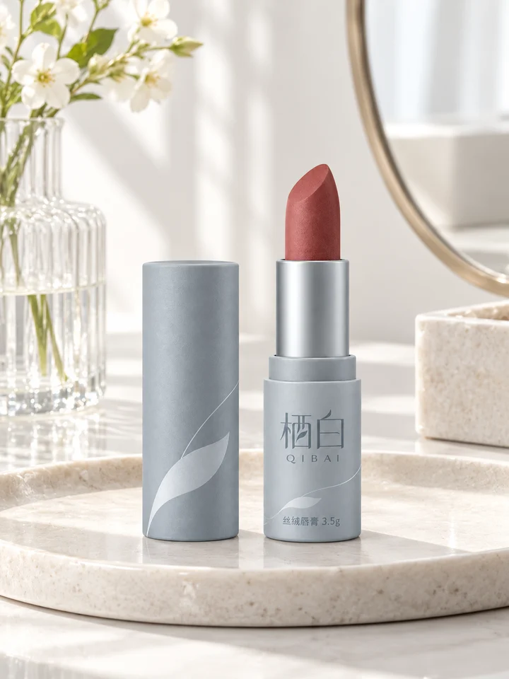</a><br><sub><b>مستحضرات التجميل</b><br>منشور على Xiaohongshu</sub></td><td align="center" valign="top"><a href="assets/examples/c02-category-4x5-1122x1402.png">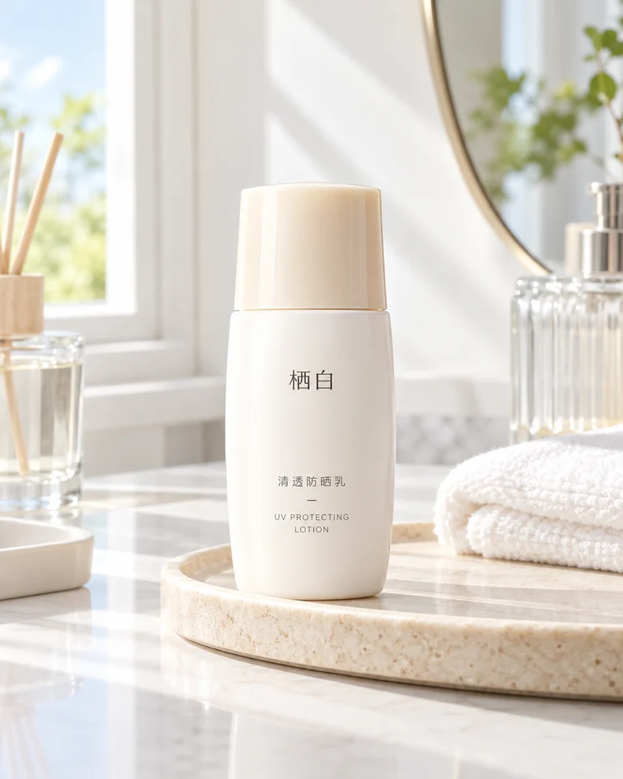</a><br><sub><b>العناية بالبشرة</b><br>منشور على وسائل التواصل</sub></td><td align="center" valign="top"><a href="assets/examples/c04-category-3x4-1086x1448.png">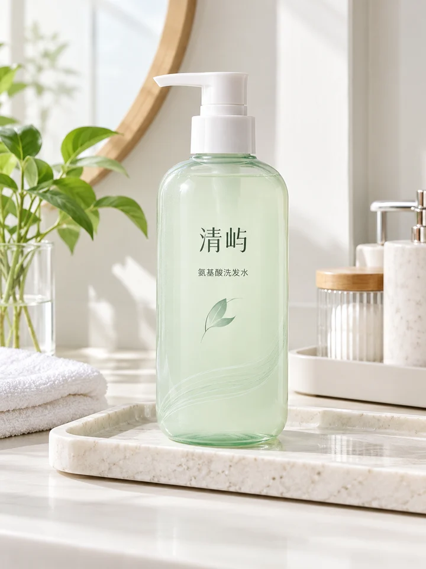</a><br><sub><b>العناية الشخصية والتنظيف</b><br>منشور على Xiaohongshu</sub></td><td align="center" valign="top"><a href="assets/examples/c06-category-4x5-1122x1402.png">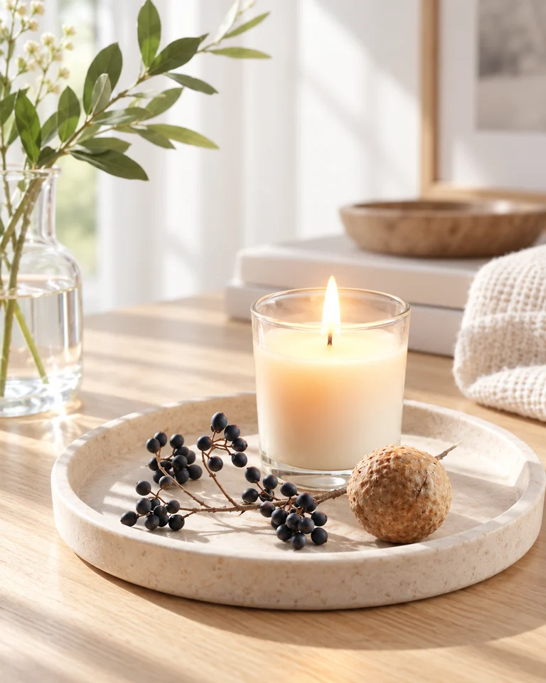</a><br><sub><b>عطور المنزل</b><br>منشور على وسائل التواصل</sub></td><td align="center" valign="top"><a href="assets/examples/s07-category-1x1-1254x1254.png">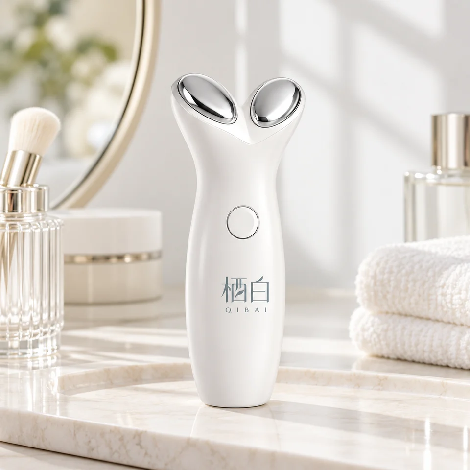</a><br><sub><b>أجهزة التجميل</b><br>صورة رئيسية في مشهد حياتي</sub></td></tr>
</table>

### منتج واحد لكل موضع عرض

المنتج نفسه والأسلوب نفسه: لكل نسبة تكوين جديد، لا قصّ.

<table>
<tr><td align="center" valign="top"><a href="assets/examples/s01-size-1x1-1254x1254.png">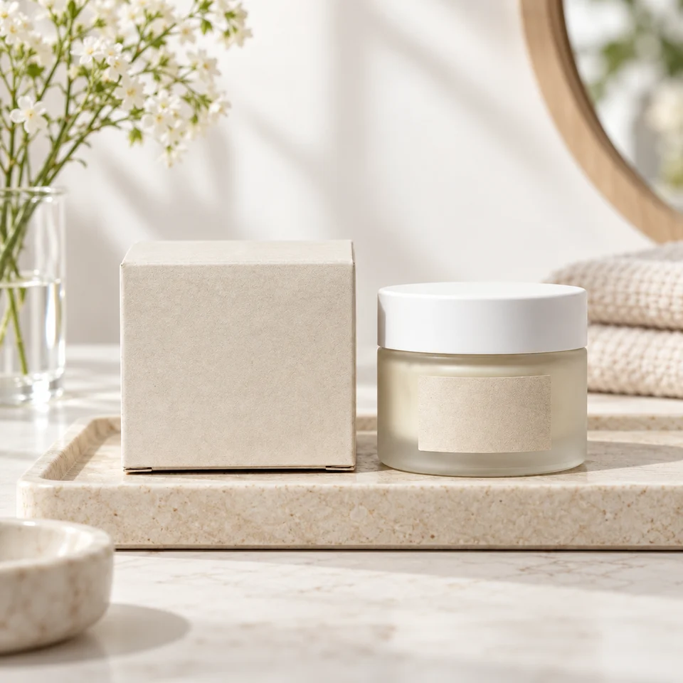</a><br><sub>صورة رئيسية في مشهد حياتي · 1:1 · 1254x1254<br>كريم بلمسة مطفأة ناعمة من QIBAI · <a href="assets/examples/sources/product-qibai-cream.jpg">صورة المنتج</a> + <a href="assets/examples/sources/logo-qibai.png">Logo</a> · بلا نص</sub></td><td align="center" valign="top"><a href="assets/examples/s02-size-3x4-1086x1448.png"></a><br><sub>منشور على Xiaohongshu · 3:4 · 1086x1448<br>كريم بلمسة مطفأة ناعمة من QIBAI · <a href="assets/examples/sources/product-qibai-cream.jpg">صورة المنتج</a> + <a href="assets/examples/sources/logo-qibai.png">Logo</a> · بلا نص</sub></td><td align="center" valign="top"><a href="assets/examples/s03-size-9x16-941x1672.png">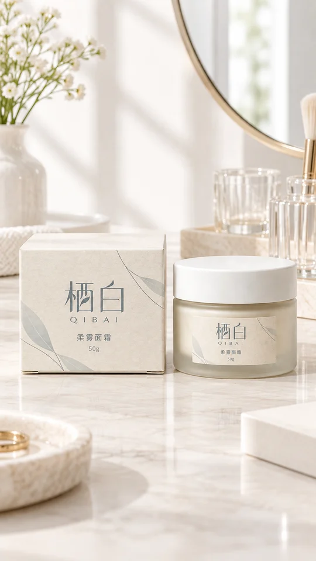</a><br><sub>إعلان عمودي في الخلاصة · 9:16 · 941x1672<br>كريم بلمسة مطفأة ناعمة من QIBAI · <a href="assets/examples/sources/product-qibai-cream.jpg">صورة المنتج</a> + <a href="assets/examples/sources/logo-qibai.png">Logo</a> · بلا نص</sub></td><td align="center" valign="top"><a href="assets/examples/s04-size-16x9-1672x941.png">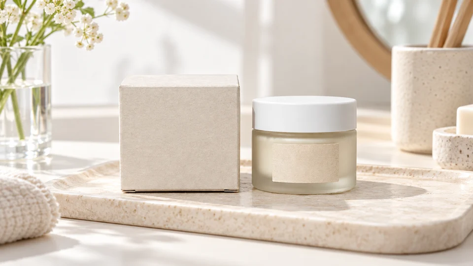</a><br><sub>شريط إعلاني · 16:9 · 1672x941<br>كريم بلمسة مطفأة ناعمة من QIBAI · <a href="assets/examples/sources/product-qibai-cream.jpg">صورة المنتج</a> + <a href="assets/examples/sources/logo-qibai.png">Logo</a> · بلا نص</sub></td></tr>
</table>

### مجموعة دوّارة: بيت واحد، والصورة الأخيرة تعود إلى الأولى

<table>
<tr><td align="center" valign="top"><a href="assets/examples/p01-set-3x4-1086x1448.png">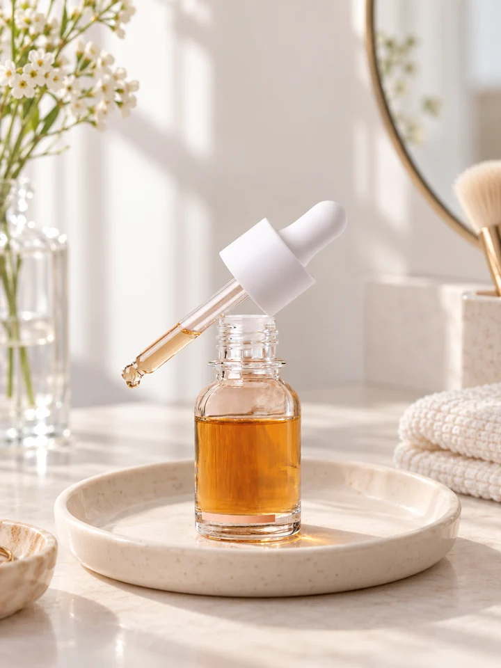</a><br><sub>منشور دوّار على Xiaohongshu · 3:4 · 1086x1448<br>زيت وجه منقٍّ من QIBAI · <a href="assets/examples/sources/product-qibai-oil.jpg">صورة المنتج</a> + <a href="assets/examples/sources/logo-qibai.png">Logo</a> · بلا نص<br>1 من 4</sub></td><td align="center" valign="top"><a href="assets/examples/p02-set-3x4-1086x1448.png">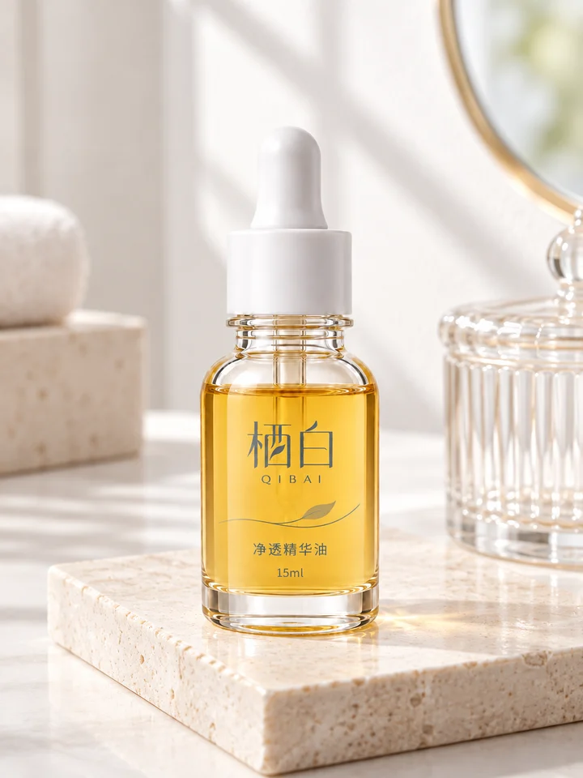</a><br><sub>منشور دوّار على Xiaohongshu · 3:4 · 1086x1448<br>زيت وجه منقٍّ من QIBAI · <a href="assets/examples/sources/product-qibai-oil.jpg">صورة المنتج</a> + <a href="assets/examples/sources/logo-qibai.png">Logo</a> · بلا نص<br>2 من 4</sub></td><td align="center" valign="top"><a href="assets/examples/p03-set-3x4-1086x1448.png">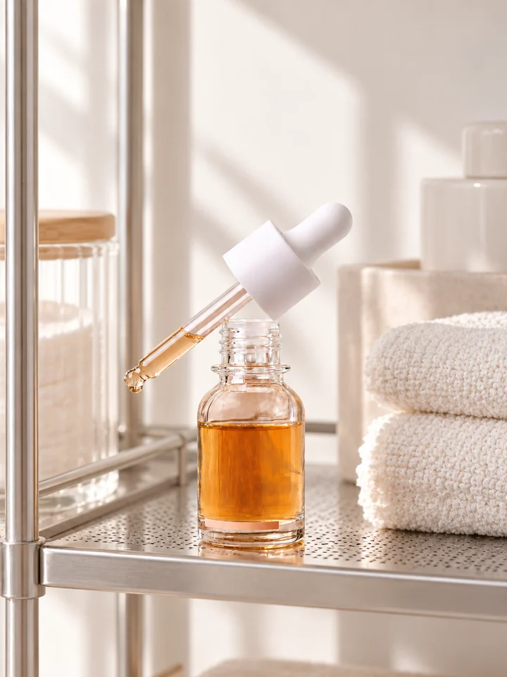</a><br><sub>منشور دوّار على Xiaohongshu · 3:4 · 1086x1448<br>زيت وجه منقٍّ من QIBAI · <a href="assets/examples/sources/product-qibai-oil.jpg">صورة المنتج</a> + <a href="assets/examples/sources/logo-qibai.png">Logo</a> · بلا نص<br>3 من 4</sub></td><td align="center" valign="top"><a href="assets/examples/p04-set-3x4-1086x1448.png">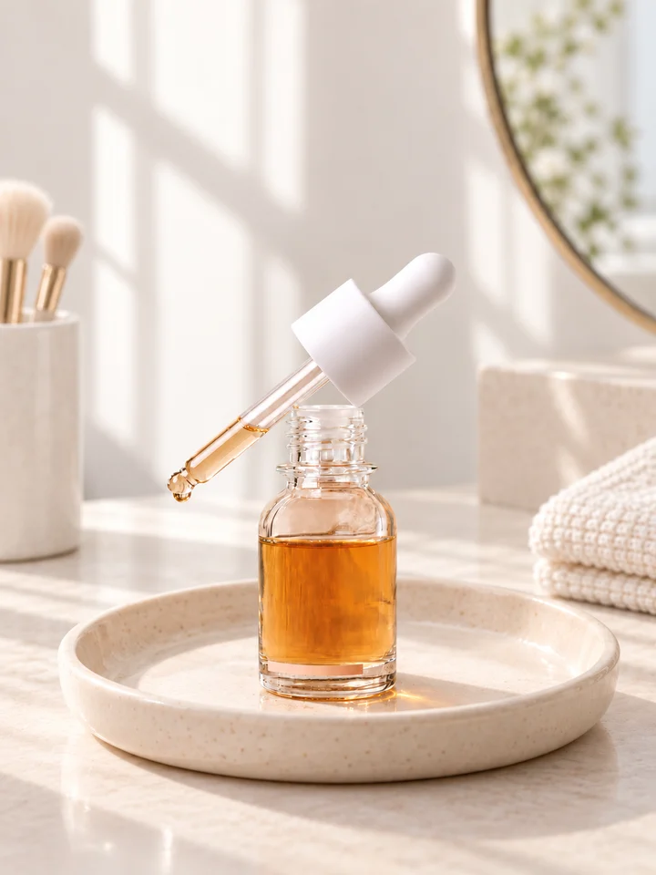</a><br><sub>منشور دوّار على Xiaohongshu · 3:4 · 1086x1448<br>زيت وجه منقٍّ من QIBAI · <a href="assets/examples/sources/product-qibai-oil.jpg">صورة المنتج</a> + <a href="assets/examples/sources/logo-qibai.png">Logo</a> · بلا نص<br>4 من 4</sub></td></tr>
</table>

### يصلح لفئات مختلفة أيضاً

<table>
<tr><td align="center" valign="top"><a href="assets/examples/c01-category-3x4-1086x1448.png"></a><br><sub>منشور على Xiaohongshu · 3:4 · 1086x1448<br>أحمر شفاه مخملي من QIBAI · <a href="assets/examples/sources/product-qibai-lipstick.jpg">صورة المنتج</a> + <a href="assets/examples/sources/logo-qibai.png">Logo</a> · بلا نص</sub></td><td align="center" valign="top"><a href="assets/examples/c02-category-4x5-1122x1402.png"></a><br><sub>منشور على وسائل التواصل · 4:5 · 1122x1402<br>واقي شمس شفاف من QIBAI · <a href="assets/examples/sources/product-qibai-sunscreen.jpg">صورة المنتج</a> + <a href="assets/examples/sources/logo-qibai.png">Logo</a> · بلا نص</sub></td><td align="center" valign="top"><a href="assets/examples/c03-category-1x1-1254x1254.png">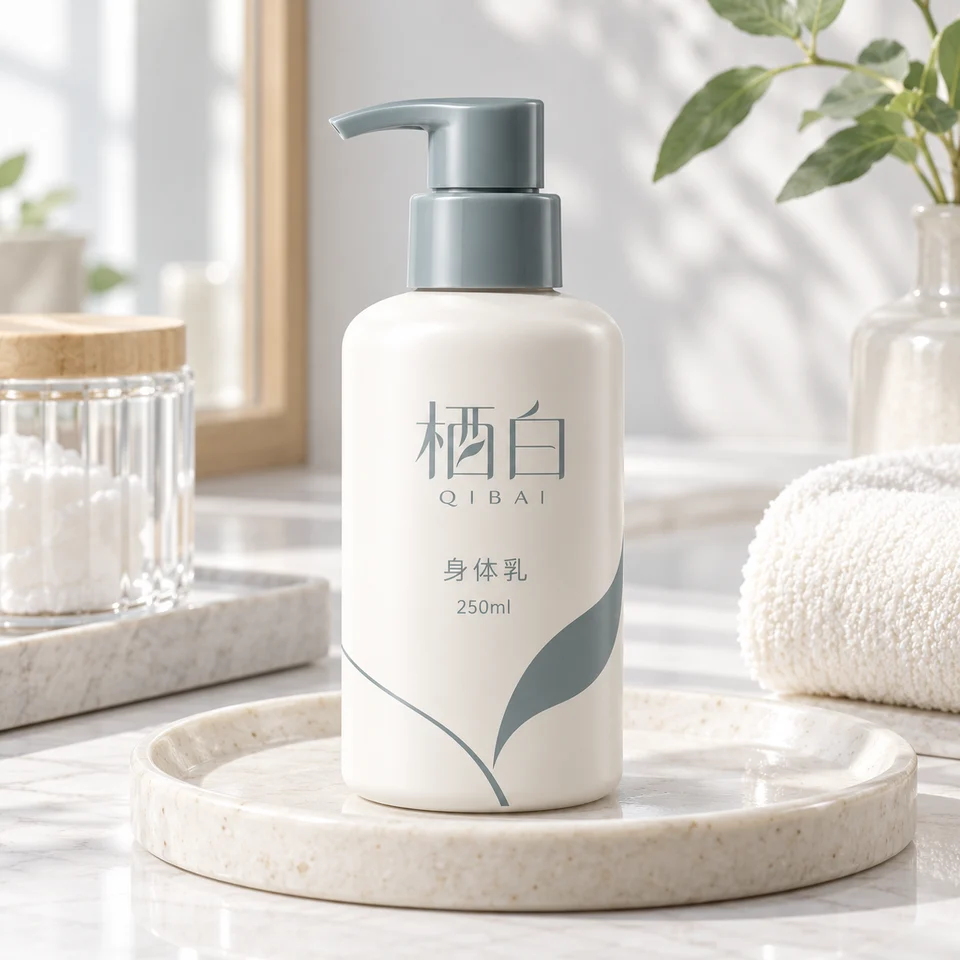</a><br><sub>صورة رئيسية في مشهد حياتي · 1:1 · 1254x1254<br>لوشن الجسم من QIBAI · <a href="assets/examples/sources/product-qibai-lotion.jpg">صورة المنتج</a> + <a href="assets/examples/sources/logo-qibai.png">Logo</a> · بلا نص</sub></td></tr>
<tr><td align="center" valign="top"><a href="assets/examples/c04-category-3x4-1086x1448.png"></a><br><sub>منشور على Xiaohongshu · 3:4 · 1086x1448<br>شامبو بالأحماض الأمينية من QINGYU · <a href="assets/examples/sources/product-qy-shampoo.jpg">صورة المنتج</a> + <a href="assets/examples/sources/logo-qingyu.png">Logo</a> · بلا نص</sub></td><td align="center" valign="top"><a href="assets/examples/c05-category-1x1-1254x1254.png">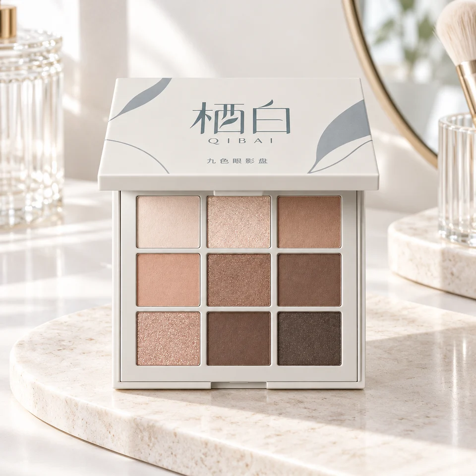</a><br><sub>صورة رئيسية في مشهد حياتي · 1:1 · 1254x1254<br>لوحة ظلال عيون بتسعة ألوان من QIBAI · <a href="assets/examples/sources/product-qibai-palette.jpg">صورة المنتج</a> + <a href="assets/examples/sources/logo-qibai.png">Logo</a> · بلا نص</sub></td><td align="center" valign="top"><a href="assets/examples/c06-category-4x5-1122x1402.png"></a><br><sub>منشور على وسائل التواصل · 4:5 · 1122x1402<br>شمعة معطّرة من WUYU · <a href="assets/examples/sources/product-wuyu-candle.jpg">صورة المنتج</a> + <a href="assets/examples/sources/logo-wuyu.png">Logo</a> · بلا نص</sub></td></tr>
<tr><td align="center" valign="top"><a href="assets/examples/s05-category-3x4-1086x1448.png">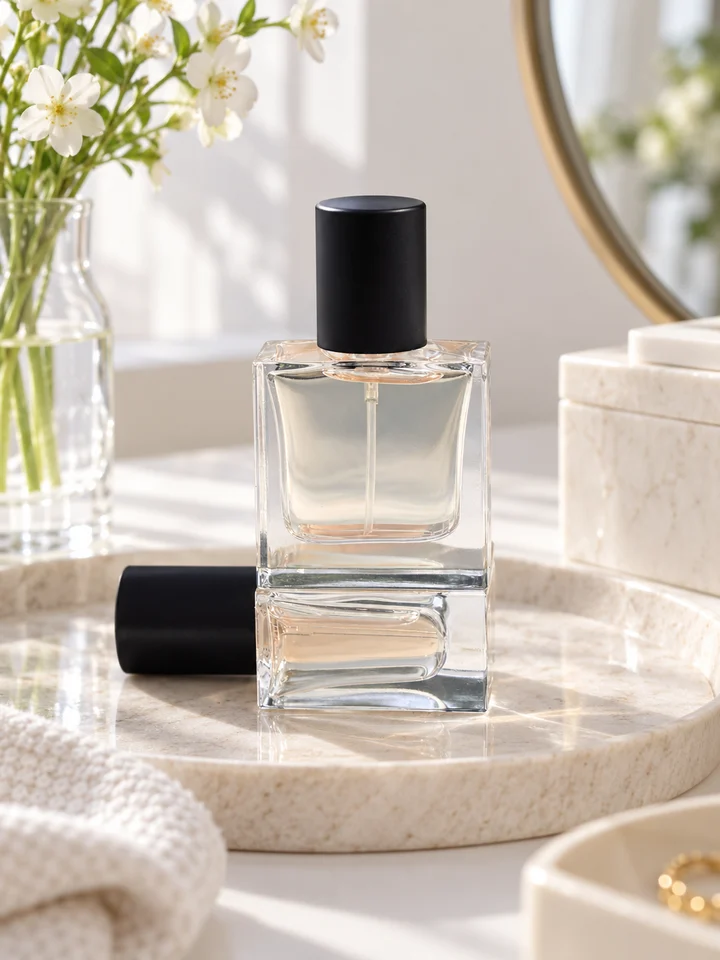</a><br><sub>منشور على Xiaohongshu · 3:4 · 1086x1448<br>ماء تواليت «ضباب الصباح» من WUYU · <a href="assets/examples/sources/product-wuyu-perfume.jpg">صورة المنتج</a> + <a href="assets/examples/sources/logo-wuyu.png">Logo</a> · بلا نص</sub></td><td align="center" valign="top"><a href="assets/examples/s06-category-4x5-1122x1402.png">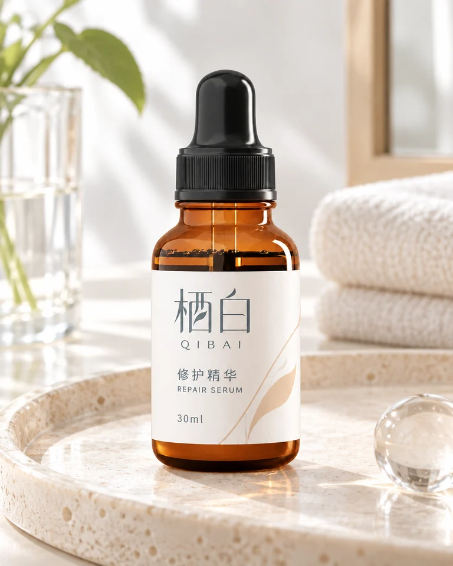</a><br><sub>منشور على وسائل التواصل · 4:5 · 1122x1402<br>سيروم الإصلاح من QIBAI · <a href="assets/examples/sources/product-qibai-serum.jpg">صورة المنتج</a> + <a href="assets/examples/sources/logo-qibai.png">Logo</a> · بلا نص</sub></td><td align="center" valign="top"><a href="assets/examples/s07-category-1x1-1254x1254.png"></a><br><sub>صورة رئيسية في مشهد حياتي · 1:1 · 1254x1254<br>جهاز التيار الدقيق للبشرة من QIBAI · <a href="assets/examples/sources/product-qibai-device.jpg">صورة المنتج</a> + <a href="assets/examples/sources/logo-qibai.png">Logo</a> · بلا نص</sub></td></tr>
</table>

<sub>كل منتجات النماذج علامات تجريبية خيالية، والأسعار والمواصفات أرقام تجريبية. صور المنتجات والشعارات التجريبية صُنعت لهذا المشروع، وبعضها مبني على صور من Unsplash؛ الإسناد والترخيص في [assets/examples/README.md](assets/examples/README.md). كل صورة ناتج توليد واحد كامل، بلا تنقيح أو تركيب أو تكبير، مع مقاسها الحقيقي بالبكسل. الصور التي لم تجتز المراجعة البصرية أُعيد توليدها ولا تظهر هنا. انقر لعرض الحجم الكامل.</sub>

<!-- xxd-samples:end -->

## ما المشكلة التي يحلها

تفشل صور التجميل الحياتية بطريقتين: إما أن تكون استوديوية جداً فتُقرأ إعلاناً، أو يتحول «العفوي» إلى فوضى — سطح مزدحم ونص ملصق ضائع في الانعكاسات.

يمشي **Shop 005** على الخط بينهما: **إحساس يومي بكاميرا حقيقية، بترتيب بيت شخص ذي ذوق رفيع.** ضوء نهار داخلي عالي الإضاءة يملأ المكان بلا زوايا مظلمة ولا ظلال ثقيلة؛ الأغراض قليلة ومصفوفة بعناية؛ والمنتج على طبق خزفي أو صينية حجرية أو سطح نظيف، هو الأسطع والأكمل والأوضح في الإطار.

## كيف يختلف عن غيره

- **بلا نص.** إنها صورة فوتوغرافية لا ملصق: لا عناوين ولا ملصقات افتراضياً، ولا يسأل عن النص.
- **مشرق.** يرفض الأسلوب المساحات المظلمة الكبيرة والخلفيات السوداء والضوء الجانبي الحاد؛ للمظهر الداكن الفاخر يناسبك أكثر [001](https://github.com/nevertoday/xxd-shop-001) أو 011.

## المجموعة الدوّارة

اطلب مجموعة دوّارة (4 صور افتراضياً، ومن 3 إلى 6) وستحصل على عدة أركان من البيت النظيف نفسه: طبق خزفي، صينية حجرية، خزانة تخزين، أمام مرآة الزينة… كل صورة تغيّر السطح أو المسافة بينما يبقى الضوء والخامات في بيت واحد. وتعود الأخيرة إلى الموضع الأول بمسافة مختلفة فتكتمل الدورة.

## ما تحضّره

- **صورة المنتج** (موصى بها): بخلفية بيضاء أو واقعية؛ يُحافَظ على نص الزجاجة وشعارها وملصقاتها. وللنص الصغير على الملصق، أهم شيء لقطة أمامية واضحة واحدة.
- **أو اسم المنتج:** يمكنه العمل من الاسم وحده.
- **الاستخدام** (موصى به): «سيروم الصباح»، «لوشن الجسم في الحمّام» — يتبعه المشهد والأغراض.

## طريقة الاستخدام

### الخطوة 1: التثبيت (مرة واحدة)

```bash
git clone https://github.com/nevertoday/xxd-shop-005.git
mkdir -p ~/.claude/skills
ln -s "$(pwd)/xxd-shop-005" ~/.claude/skills/xxd-shop-005
```

مستخدمو Codex يربطون المجلد نفسه بـ `~/.codex/skills/xxd-shop-005`. أعد تشغيل جلسة مساعدك الذكي بعد التثبيت.

### الخطوة 2: قل ما تريد بكلمات بسيطة

```text
/xxd-shop-005 اصنع صورة حياتية لسيروم النياسيناميد هذا
/xxd-shop-005 الشامبو وكريم اليدين جنباً إلى جنب، لكل منهما مشهده، 3:2
/xxd-shop-005 اصنع مجموعة دوّارة من 4 صور لهذا السيروم
```

لا معاملات لتحفظها. كل ما تتركه مفتوحاً، كالمقاسات أو العدد، يُسأل عنه مرة واحدة، ويمكنك في المرة التالية إعادة استخدام إعداداتك السابقة.

### الخطوة 3: ما يفعله بعد ذلك

1. يقرأ صورة منتجك ووصفه ولا يسأل إلا عمّا بقي مفتوحاً؛ وتُقترح المقاسات من الاستخدام مع أبعادها بالبكسل.
2. لا يضيف هذا الأسلوب نصاً افتراضياً ولا يسأل عنه.
3. في المجموعة الدوّارة، ترى أولاً لوحة القصة والصورة الأولى؛ ويتبع الباقي بعد تأكيدك.
4. يُكوَّن كل مقاس من جديد، ولا يُقصّ أبداً من صورة أخرى.
5. يفحص كل صورة قبل التسليم: هل المنتج دون تغيير، وهل النص مكتوب صحيحاً، وهل توجد أرقام لم تعطها؟ وما يفشل يُبلَّغ عنه ويُعاد.
6. يحفظ ملفات PNG في مجلد مهمة جديد تحت `~/Desktop/xxd/xxd-shop-005/` ويعطيك المسار.

<details>
<summary><strong>متقدم: معاملات الأوامر (لاحقاً)</strong></summary>

```text
/xxd-shop-005 ./serum.png --product "Niacinamide serum 30 ml" --use "lifestyle post" --size 3:4 --text none
/xxd-shop-005 ./shampoo.png ./hand-cream.png --size 3:2 --text none Two products side by side, each in its own scene
```

المعاملات الرئيسية: `--product` و`--use` و`--size` و`--count` و`--text none` (افتراضي، ولا يُسأل عنه). القائمة الكاملة في [مرجع التشغيل](references/shop-runtime.md).

</details>

## الأسئلة الشائعة

**أي مقاس أستخدم؟**

3:4 لـ Xiaohongshu، و1:1 لصور مشاهد المتجر، و3:2 لمنتجين جنباً إلى جنب.

**هل يكتب الفوائد على الصورة؟**

لا. النص الوحيد هو نص عبوة المنتج نفسها.

**ماذا أحتاج؟**

ثلاثة أشياء: ① مساعد ذكي يدعم الـ Skills، مثل Claude Code أو Codex؛ ② نموذج قادر على توليد الصور — توليد الصور المدمج في مساعدك، أو مزوّد نماذج مُعدّ في Codex يولّد الصور عبر Responses API (افتراضياً GPT Image 2)؛ ③ Python 3.11 أو أحدث مع Pillow (`pip install pillow`).

**هل له تكلفة؟ وهل يمكنني استخدامه تجارياً؟**

تنزيل الـ Skill مجاني؛ وتكلفة توليد الصور تُحتسب على حساب النموذج الخاص بك. يستخدم المشروع ترخيص PolyForm Noncommercial: التعلم الشخصي والبحث والاختبار مسموح بها؛ أما إدارة متجر أو العمل لعملاء أو أي استخدام تجاري آخر فيحتاج أولاً إلى إذن كتابي من المؤلف — راجع «الترخيص» في النهاية.

**ما حجم الصور؟**

يمكنك طلب نسبة أو بكسلات محددة. الحجم الحقيقي هو ما يعيده النموذج — دون تكبير سري أبداً — واسم الملف يذكر البكسلات الحقيقية.

**هل سيحتوي النص في الصورة على أخطاء إملائية؟**

صور الذكاء الاصطناعي تخطئ أحياناً في الكلمات أو تضيف علامات صغيرة مثل ® بجوار اسم العلامة. تُكبَّر كل صورة وتُفحص قبل التسليم، وأي فشل يُعاد؛ وكل النماذج في هذه الصفحة اجتازت ذلك الفحص.

**هل سيختلق أسعاراً أو أرقام مبيعات؟**

لا. كل ما يبدو حقيقة — السعر والمواصفات والمنشأ والمبيعات والجوائز والشهادات — يأتي فقط مما تقدمه أو من نص مقروء بوضوح على المنتج؛ وإلا يُترك، بلا عنصر نائب «¥XX».

**هل يتعامل مع منتجات كثيرة دفعة واحدة؟**

نعم. أعطه مجلداً من صور المنتجات: كل صورة منتج واحد، ويُسأل عن المقاسات والنص مرة واحدة، ولا تتسرب حقائق أي منتج أو نصوصه إلى غيره.

## المبادئ

- **يبقى الأسلوب وفياً لأصله:** خلف هذا الـ Skill موجّه تصميم تجاري ناضج ([الموجّه الأصلي](references/original-prompt/zh-CN.md) · [ترجمة إنجليزية للاطلاع](references/original-prompt/en.md)). لا يعيد الـ Skill كتابته ولا يضيف ألوانه أو توجيهه الفني الخاص؛ بل يسلّم النموذج منتجك ومقاساتك ونصك وحقائقك فقط.
- **لا يُعاد تصميم المنتج:** مع صورة المنتج، يتبع الشكلُ واللونُ ونصُ العبوة والشعارُ الصورةَ.
- **حقائقك وحدها،** وكل منتج قائم بذاته — لا شيء مستعار من منتجات أخرى أو نتائج سابقة أو نماذج.
- **صور PNG نقطية حقيقية،** لا SVG ولا رسوم بالكود تُقدَّم على أنها صور؛ وكل تشغيل ينشئ مجلد مهمة جديداً.
- لا يُعاد أبداً كتابة نص الزجاجة أو شعارها أو تشويهه.

<!-- xxd-shop-tail -->
<details>
<summary><strong>بنية المشروع (للمطوّرين)</strong></summary>

```text
xxd-shop-005/
├── SKILL.md
├── README.md / README.en.md / README.ja.md / README.ko.md / README.ar.md
├── LICENSE
├── agents/openai.yaml
├── assets/examples/
├── scripts/
│   ├── configured_imagegen.py
│   ├── clean_marks.py
│   └── shop_preferences.py
└── references/
    ├── shop-runtime.md
    ├── runtime-preferences.md
    ├── sample-workflow.md
    └── original-prompt/
        ├── README.md
        ├── zh-CN.md
        └── en.md
```

</details>

<!-- xxd-readme-ads:start -->
## عن XXD

XXD هو اختصار اسم علامة Xiaoxiaodong. أنشأ هذا المشروع ويديره [@xiaoxiaodong01](https://x.com/xiaoxiaodong01).

## عضوية Xiaoxiaodong متعددة المنصات · 699 يواناً صينياً سنوياً

> **إفصاح إعلاني:** رمز QR وروابط العضوية والخدمات المدفوعة أدناه معلومات ترويجية من XXD. المسح أو الشراء اختياري تماماً ولا يؤثر في استخدام المشروع المفتوح المصدر.

تفتح عضوية سنوية واحدة ثلاث مزايا معاً: **Knowledge Planet + مكتبة توجيهات أعضاء XXD + عضوية جميع Skills من مستوى General**. المزايا الثلاث ضمن عضوية واحدة ولا يلزم شراء منفصل.

<!-- xxd-shop-command-system:start -->

### كيف تتعاون الـ Skills

| المستوى | ما يتضمنه | المهمة |
|---|---|---|
| **General** | `xxd-shop-all` | يكتشف Skills المرقمة المتاحة، ويرشحها حسب المنتج وموضع العرض والاحتياج البصري، وينظم المهام متعددة الأساليب والدفع بالجملة. |
| **Soldier** | `xxd-shop-NNN` | تنفذ كل مهارة مرقمة موجّهها الأصلي وجماليتها الخاصة، وتنجز المهمة المحددة التي يوزعها General. |

<!-- xxd-shop-command-system:end -->

### ماذا تحصل عليه

1. **استشارات فردية عبر WeChat لتعلّم الذكاء الاصطناعي والمشاريع**
   أضف Xiaoxiaodong على WeChat عبر رمز QR أدناه للتواصل الفردي حول تعلّم الذكاء الاصطناعي والأدوات والمشاريع العملية والحصول على إرشادات وإجابات مفيدة. يمكن تنظيم الأسئلة المميزة ضمن محتوى الأعضاء.
2. **مكتبة توجيهات للأعضاء تتوسع باستمرار**
   تضم [مكتبة توجيهات أعضاء XXD](https://vip.xiaoxiaodong.ai/) حالياً نحو 32 ألف توجيه، وستواصل التنظيم والتوسع بهدف تجاوز 100 ألف.
3. **جميع Skills من مستوى General ودعم الاستخدام**
   تغطي عضوية واحدة جميع Skills من مستوى General، مع إرشادات ودعم للأسئلة عند الحاجة.
4. **أولوية للطلبات شديدة الاحتياج**
   تُراجع التوجيهات والـ Skills ذات الطلب المرتفع والاحتياج الفعلي وتُطوّر أولاً حيثما كان ذلك مناسباً.

### كيفية الاشتراك

- [فعّل العضوية ذاتياً من موقع الأعضاء](https://vip.xiaoxiaodong.ai/).
- أو امسح رمز QR أدناه لإضافة Xiaoxiaodong على WeChat والحصول على دعم فردي للتفعيل.

<p align="center"><a href="https://xiaoxiaodong.pages.dev/assets/wechat-qr.png"></a></p>
<!-- xxd-readme-ads:end -->

## الترخيص

يُقدَّم هذا المشروع — بما في ذلك Skill والموجّهات والبرامج النصية والوثائق والعينات المرفقة — بموجب **PolyForm Noncommercial License 1.0.0**. النص القانوني الكامل موجود في [LICENSE](LICENSE)، والصفحة الرسمية هي <https://polyformproject.org/licenses/noncommercial/1.0.0>.

بكلمات واضحة:

- يُسمح بالاستخدام الشخصي للدراسة والبحث والتجربة والاختبار والهوايات والترفيه الخاص. ويُسمح أيضاً باستخدامه من الجمعيات الخيرية والمؤسسات التعليمية ومنظمات البحث أو السلامة أو الصحة العامة ومنظمات حماية البيئة والمؤسسات الحكومية.
- لأغراض **غير تجارية**، يمكنك الاستخدام والنسخ والتعديل وإنشاء أعمال مشتقة ومشاركة المشروع. عند المشاركة، أرفق هذا الترخيص (أو الرابط أعلاه) وكل سطر `Required Notice:` يقدمه المؤلف.
- لا يُسمح بالمنتجات أو الخدمات التجارية، أو التسليم بمقابل، أو بيع حق الوصول أو التراخيص، أو أي استخدام متوقَّع له تطبيق تجاري. للاستخدام التجاري، احصل أولاً على إذن كتابي منفصل من صاحب حقوق النشر.
- يمنح الترخيص حقوق النشر وحقوق براءة الاختراع المحدودة المذكورة فقط. لا يمنح حقوق العلامات التجارية أو أسماء العلامات أو أي حقوق أخرى غير منصوص عليها، ولا يجوز إعادة ترخيصه أو نقل ترخيصك.
- عند تلقي إخطار كتابي بالمخالفة، لديك 32 يوماً للامتثال الكامل واتخاذ خطوات عملية للتصحيح؛ وإلا تنتهي التراخيص. كما ينهي الادعاء الكتابي بانتهاك براءة اختراع ترخيص البراءة.
- يُقدَّم المشروع **كما هو**، بلا ضمانات إلى الحد الذي يسمح به القانون، وتتحمل أنت مخاطر الاستخدام وأي أضرار ناتجة عنه.
